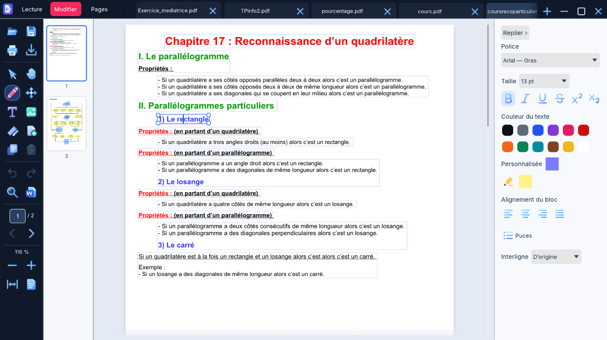
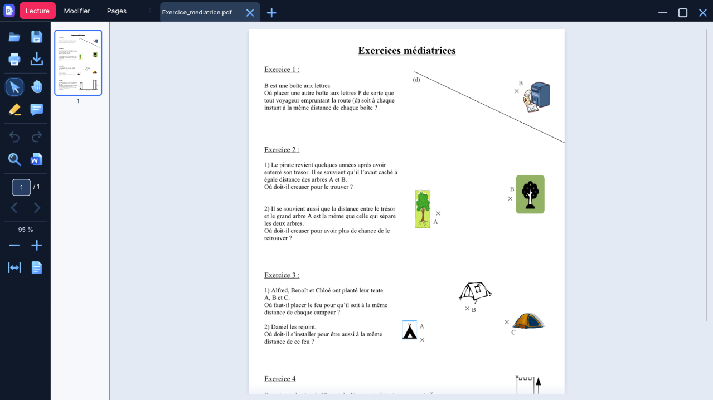
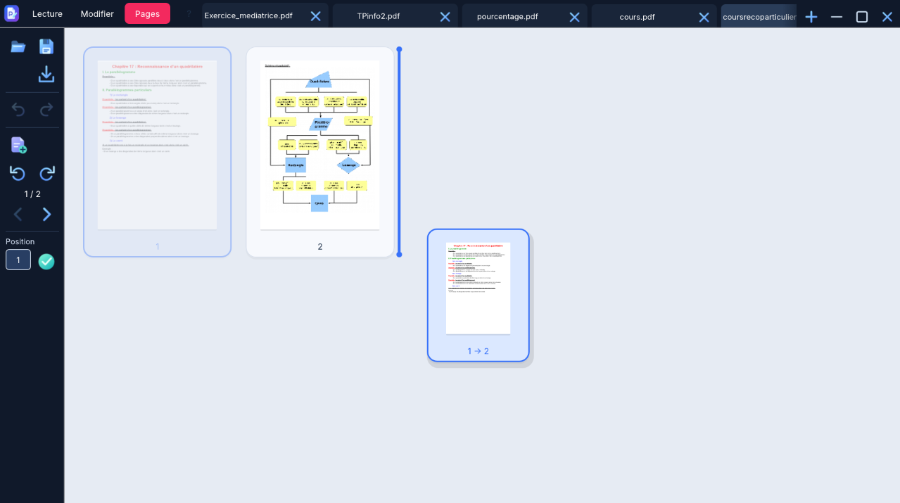

  

  <strong>Vos PDF, prêts à être retravaillés.</strong> 
  Corrigez un texte, annotez un cours, réorganisez vos pages et repartez avec le bon document.

  <strong>Gratuit</strong> &nbsp;·&nbsp; <strong>Hors ligne</strong> &nbsp;·&nbsp; <strong>Sans compte</strong> &nbsp;·&nbsp; Windows 10 / 11 x64

  
  &nbsp;
  

  Version <strong>1.0.5</strong> &nbsp;·&nbsp;
  <a href="https://github.com/jossmair/PDFinator/releases/latest">Tous les téléchargements</a> &nbsp;·&nbsp;
  <a href="https://github.com/jossmair/PDFinator/releases/download/v1.0.5/SHA256SUMS.txt">Vérifier les fichiers</a>

---

## Corrigez votre document, directement sur la page

Une phrase à changer, un titre à mettre en valeur, une précision à ajouter ?
Modifiez les blocs de texte reconnus à leur emplacement et retrouvez les réglages
de police, de taille, de couleur et d’alignement à droite.

Un schéma groupé ? Dans Modifier, faites un clic droit puis **Dissocier le schéma**
pour accéder à ses éléments compatibles. [Voir le fonctionnement et les limites](GROUPS.md).

## Un espace pour lire et annoter

Parcourez vos documents avec les miniatures, la recherche, le zoom et l’outil Main.
Ajoutez un surlignage ou un commentaire pour retrouver l’essentiel.

## Vos pages dans le bon ordre

Glissez les miniatures pour réorganiser un document. Ajoutez d’autres PDF,
tournez une page ou insérez une page blanche pour préparer votre version finale.

## Un outil pour chaque étape

| Ce que vous voulez faire | Ce que PDFinator propose |
| --- | --- |
| **Retoucher un document** | Modifier ou insérer du texte, régler les styles, ajouter des puces et ajuster les interlignes. |
| **Travailler sur un scan** | Reconnaissance OCR locale du texte des images, puis création de blocs modifiables. Une relecture reste nécessaire. |
| **Illustrer et compléter** | Images avec rognage par clic droit, traits, formes et tableaux avec réglages de couleur et d’épaisseur. |
| **Assembler vos contenus** | Ajout de PDF, déplacement des pages et des onglets, copier-coller de blocs entre documents. |
| **Continuer dans un traitement de texte** | Exporter une copie éditable en **DOCX ou ODT**, avec reconstruction de la disposition. |
| **Garder la main sur votre travail** | Annuler/rétablir, enregistrer sous un autre nom et récupérer le travail après une interruption. |

## Prêt en quelques clics

| **Installer PDFinator** | **L’emporter avec vous** |
| --- | --- |
| Téléchargez l’**installeur EXE**, puis suivez l’assistant en français. | Téléchargez le **ZIP portable**, extrayez-le entièrement, puis ouvrez **PDFinator.exe**. |
| Installation pour votre compte Windows, avec raccourcis. | Aucun interpréteur ni installation supplémentaire nécessaire. |
| [**Télécharger l’installeur · 9,6 Mo**](https://github.com/jossmair/PDFinator/releases/download/v1.0.5/PDFinator-1.0.5-Setup.exe) | [**Télécharger le portable · 10,8 Mo**](https://github.com/jossmair/PDFinator/releases/download/v1.0.5/PDFinator-1.0.5-portable-exe-windows-x64.zip) |

Pour la version portable, lancez le programme **après extraction**, et conservez
`LICENCES.txt` à ses côtés. Aucun téléchargement n’est nécessaire pendant
l’installation ou l’utilisation du logiciel.

## Le code est disponible

Retrouvez les sources Rust, les tests, les ressources et les dépendances locales
directement dans ce dépôt. Pour reconstruire l’application ou préparer une
distribution Windows, suivez le [guide de compilation](BUILDING.md).

Les priorités de développement sont suivies dans la [feuille de route](ROADMAP.md).
Pour proposer un correctif, consultez [CONTRIBUTING.md](CONTRIBUTING.md) ; pour un
problème sensible, suivez [SECURITY.md](SECURITY.md).

[Sources 1.0.5](https://github.com/jossmair/PDFinator/tree/v1.0.5) · [Archive des sources 1.0.5](https://github.com/jossmair/PDFinator/archive/refs/tags/v1.0.5.zip) · [Anciennes sources V1](https://github.com/jossmair/PDFinator/tree/v1.0.0-sources)

<strong>Compatibilité, vérifications et limites connues</strong>

Windows 10/11 x64. Les exécutables ne sont pas signés Authenticode.
L’OCR nécessite une langue de reconnaissance disponible dans Windows ; sa qualité
dépend de l’image. La modification et l’export Office dépendent de la structure du
PDF et des polices : une reproduction identique de tous les documents n’est pas
garantie. Relisez vos résultats OCR et vos fichiers convertis.
Les fichiers dépassant 256 Mio ne sont pas ouverts par cette version.

**188 tests automatisés réussis** pour la version 1.0.5, complétés par des vérifications
d’export, de récupération et des fichiers de distribution. Cela ne couvre pas tous
les PDF, toutes les configurations Windows ou tous les pilotes d’imprimante.

[Notes de version et limites détaillées](CHANGELOG.md) · [Validation](VALIDATION.md)

---

  <strong>Un retour, une idée, un problème ?</strong> 
  <a href="https://github.com/jossmair/PDFinator/issues">Ouvrir un signalement</a> &nbsp;·&nbsp;
  <a href="https://github.com/jossmair/PDFinator/releases/latest">Télécharger PDFinator</a>

Ce dépôt contient le code source, les versions Windows, leur documentation et
les captures de présentation. Les mentions légales des composants accompagnent les téléchargements.
Ne joignez pas de document contenant des informations personnelles à un signalement public.
